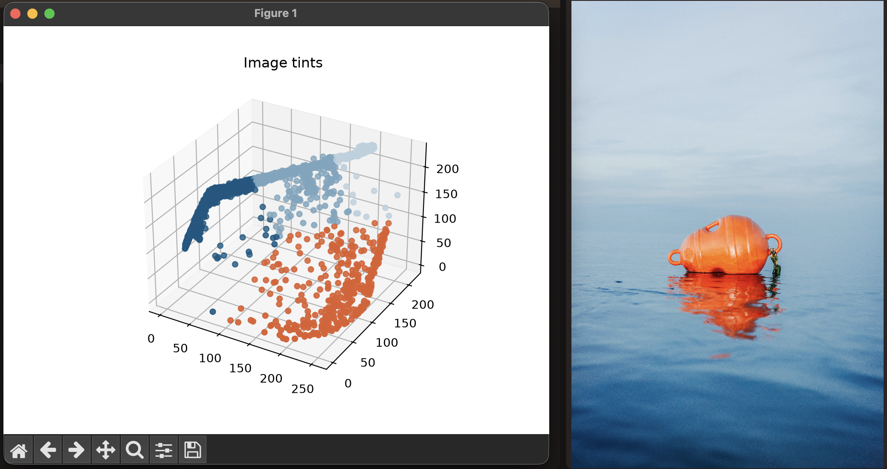

# tint

Extract a color palette from an image.

tint shrinks the image, groups its pixels into a number of colors with k-means clustering, and prints the color at the
center of each group. It also shows a 3D plot of every pixel in RGB space, colored by the group it belongs to.

The starting points for the clustering are picked at random, so the colors can differ slightly between runs.

## Requirements

- [uv](https://docs.astral.sh/uv/)

## Usage

```sh
uv run main.py <image_path> [--nr-colors N] [--width W] [--height H]
```

| Option        | Default | Description                                     |
|---------------|---------|-------------------------------------------------|
| `image_path`  |         | Path to the image                               |
| `--nr-colors` | `4`     | Number of colors in the palette                 |
| `--width`     | `100`   | Width to shrink the image to before clustering  |
| `--height`    | `100`   | Height to shrink the image to before clustering |

`--width` and `--height` can be used to lower the image resolution. Smaller images are faster to cluster. Larger ones
may pick up more detail.

### Example

```sh
uv run main.py tint/images/1.jpg
```

```
{'R': 224, 'G': 93, 'B': 44}
{'R': 120, 'G': 165, 'B': 190}
{'R': 11, 'G': 87, 'B': 129}
{'R': 187, 'G': 208, 'B': 222}
```


